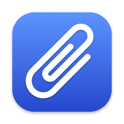
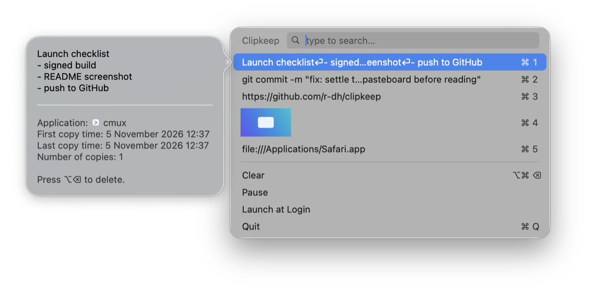

<div align="center">



# Clipkeep

**Clipboard history for macOS that never touches the disk.**

The Maccy experience in ~1,700 lines of Swift, with zero dependencies, no network access and no Accessibility permission.




</div>

## Why

Clipboard managers see every password, token and key you copy. Most persist that history to disk and update themselves from someone else's repository. Clipkeep is small enough to read in an afternoon and build yourself.

| | Maccy 2.6.1 | Clipkeep |
|---|---|---|
| Third-party packages | 9 | **0** |
| Auto-updater | Sparkle | **none** |
| History on disk | SQLite, unencrypted | **never** |
| Entitlements | sandbox, user-selected files, mach-lookup exception | **sandbox only** |
| Idle memory | 132 MB | **11 MB** |

## Install

```sh
git clone https://github.com/r-dh/clipkeep && cd clipkeep
./build.sh
cp -R build/Clipkeep.app ~/Applications/ && open ~/Applications/Clipkeep.app
```

Needs the Xcode command line tools. Enable *Launch at Login* from the popup footer.

## Use

| Key | Action |
|---|---|
| <kbd>⇧⌘C</kbd> | Open at the cursor. Keep <kbd>⇧⌘</kbd> held and tap <kbd>C</kbd> to cycle, release to copy |
| type | Filter, matches in bold |
| <kbd>↩</kbd> or click | Copy, then paste with <kbd>⌘V</kbd> |
| <kbd>⌘1</kbd>…<kbd>⌘9</kbd> | Copy entry 1 to 9 |
| <kbd>↑</kbd> <kbd>↓</kbd> <kbd>⌘↑</kbd> <kbd>⌘↓</kbd> <kbd>⌃N</kbd> <kbd>⌃P</kbd> | Navigate |
| <kbd>⌥⌫</kbd> | Delete entry |
| <kbd>⌥⌘⌫</kbd> | Clear history |
| <kbd>⌥</kbd>-click menu bar icon | Pause recording |

Hover an entry for 1.5 s to preview it.

## Security model

- **Memory only.** Quit or reboot and the history is gone.
- **Sandboxed with no other entitlements.** The OS denies network and file access. This stops accidental leaks, not an attacker who has already exploited the process.
- **No Accessibility permission.** Carbon hotkey; Clipkeep never types for you.
- **Marked secrets are never read.** Copies flagged `ConcealedType`, `TransientType` or `AutoGeneratedType` (1Password and other password managers) are skipped on their declared types alone. Browser and web-page copies cannot carry the flag, so pause for those.
- **Tracking metadata dropped.** Chrome source URLs and Safari web archives are not kept.
- **Hostile input bounded.** Linear-time HTML stripping instead of WebKit, images decoded only when the bytes match the declared format and under 100 MP, 16 MB per entry, 96 MB and 25 entries in total.
- **Hidden from screen capture** (`sharingType = .none`). Some sharing apps ignore this flag.

Picking an entry puts it back on the system clipboard like any copy, so other apps and Universal Clipboard can read it again.

## Credits

Look and feel follow [Maccy](https://github.com/p0deje/Maccy); the menu bar paperclip is Maccy's (MIT, [license](Resources/MACCY-LICENSE)). The app icon is drawn by [`Tools/make-icon.swift`](Tools/make-icon.swift).
